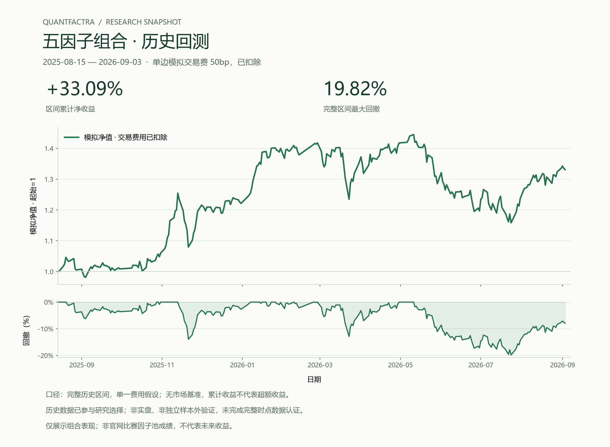

<p align="center"></p>

# QuantFactra

**为 AI 开发者构建可追踪的多 Agent 研究工作流。** 连接自己的模型、数据与执行平台，保留任务身份、交接、费用与证据。

[展示页](https://yanxxzz.github.io/quantfactra/) · [快速开始](docs/quickstart.md) · [架构](docs/architecture.md) · [English](README_EN.md)

## 公开项目的范围

这里发布通用框架与接口功能：角色协作、结构化消息、独立复核、任务状态、持久化恢复、模型协议和回测适配器。个人研究策略、真实研究记录、账户和运行环境属于各自的私有应用，不随框架发布。框架不包含内置因子库；策略和数据由使用者通过私有插件提供。

## 第一次运行

支持 Python 3.11 / 3.12，建议在独立虚拟环境中使用当前源码：

```bash
git clone https://github.com/Yanxxzz/quantfactra.git
cd quantfactra
python -m venv .venv
# Linux / macOS: source .venv/bin/activate
# PowerShell 可直接用 .venv\Scripts\python.exe 代替 python
python -m pip install -e .
python -m quantfactra demo --output research_runs/quickstart
python -m quantfactra team host-demo --output research_runs/team_demo
```

第一个命令生成适配器演示的本地 `report.html`；第二个走完三个脚本化 Agent 协作轮次和中断恢复。两者使用明确标注的合成输入，不访问真实账户或模型。

## 接入自己的工具

```bash
python -m quantfactra init --output research_runs/my_agent
python research_runs/my_agent/run_adapter.py
python research_runs/my_agent/run_ai.py
```

修改生成的 `my_backtest.py`、`my_planner.py`、`worker.py`，即可接入自己的平台、规划器或现有 Agent。生成目录是本机运行区，默认被 Git 忽略。

- [回测平台](docs/backends.md)：持久化 Run、明确计费、平台身份绑定。PandaAI 保留公式 CLI 适配器，bt 提供真实本地执行；自己的平台通过 `module:factory` 接入。
- [模型与 Agent](docs/model-providers.md)：Responses、Chat Completions、Anthropic Messages；支持命令行 Worker 和文件消息。
- [协作与恢复](docs/ai-integration.md)：稳定 `work_id`、角色契约、缓存回复、任务板、有限预算与明确终态。
- [发布与隐私](docs/publication.md)：独立公开源码区、逐文件批准、Git 历史与发行包检查。

## 结果展示与公开案例

### 匿名组合表现快照

经所有者批准，仅展示下面这一张组合历史回测图。完整区间采用单边 50bp 模拟交易费用，展示累计净收益和最大回撤。



历史数据已参与研究选择，尚未完成独立样本外验证及完整时点数据认证。该图不是官网比赛成绩，也不代表未来收益；策略、数据与研究过程不随图公开。

### 可复现的公开案例

案例只用于理解复现功能，不含维护者的个人研究策略。

```bash
python -m pip install -e ".[bt]"
python -m quantfactra case --output research_runs/fx_case
python -m quantfactra case --output research_runs/fx_case --resume
python -m quantfactra factor-case --download --output research_runs/french_momentum
```

[ECB 四币种示例](docs/public-research-case.md)使用公开参考汇率与简单动量；[French 经典动量](docs/published-momentum-case.md)重放已发表的组合收益。两例的市场、敞口、成本和执行范围不同，所有风险与限制保留在案例中。

## 开发

```bash
python -m pip install -e ".[dev,bt]"
python -B scripts/verify_public_research.py
python -m pytest tests -q
python scripts/check_publication.py --all-refs
```

贡献前阅读 [CONTRIBUTING](CONTRIBUTING.md)。提交只讨论通用能力或合成复现；不要在 issue、PR、截图和日志中上传个人研究文件。

MIT 许可。框架部分代码源自 QUANTAXIS / Panda Alpha 的通用执行与协作实现，保留上游版权；第三方公开示例数据使用各自的条款。
