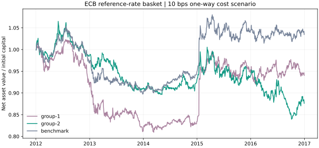

# 一个完整、可复现的公开研究案例

研究问题：**过去 20 个有效参考日的外汇动量，在滞后一日、计入交易成本后，是否超过相同调仓日的等权组合？**

本案例使用 ECB 公开参考汇率和真实的 [bt 引擎](https://github.com/pmorissette/bt)。数据随源码安装，无账户、模型、数据库或运行时下载。它与 `demo` 的合成回执不同，会产生真实引擎计算的组合净值、交易和费用。它检验一个固定样本中的假说，不提供可成交业绩认证。

## 从安装到报告

在 Python 3.11 / 3.12 的独立环境中，从仓库根目录执行：

```bash
python -m pip install -e ".[bt]"
python -m quantfactra case --output research_runs/fx_case
python -m quantfactra case --output research_runs/fx_case --resume
```

PowerShell 未激活环境时，将 `python` 换为 `.\.venv\Scripts\python.exe`。打开 `research_runs/fx_case/report.html`。重复使用原目录须加 `--resume`；已完成的 Run 只读取、校验原件，不再运行引擎，`ledger_jobs` 仍为 1。

安装会从包索引取得依赖；安装完成后，案例计算可以断网运行。没有平台服务费；交易成本按协议建模，CPU/内存费用没有计量。`bt` 是可选依赖，基础离线 `demo` 不需要它。

## 数据与固定协议

- 来源：[European Central Bank euro FX reference rates](https://www.ecb.europa.eu/stats/policy_and_exchange_rates/euro_reference_exchange_rates/html/index.en.html)，[复用条款](https://www.ecb.europa.eu/services/using-our-site/disclaimer/html/index.en.html)。数据可免费取得，独立于软件 MIT 许可，详见 [DATA_NOTICE](../quantfactra/cases/fx_momentum/DATA_NOTICE.md)。ECB 不背书本项目。
- 固定四币种 CHF、GBP、JPY、USD，以 EUR 计价。原始单位为每 1 EUR 的货币数量，取倒数得到每单位货币的 EUR 价格。
- 输入/暖机：2011-10-03 至 2016-12-30；评估：2012-01-03 至 2016-12-30。读取价格和计算前先检查已知封存区间，未触及原项目研究封存。
- 收到 1,347 个源日期、5,388 条币种记录。16 条 H 状态空报价对应四个假日日期，原字符串和状态码全部保留。仅取当日四个报价均正且有限的交集，共 1,343 日；不补值，不按未来收益筛选成员。
- 20 个有效观察日动量、滞后一个有效观察日，之后每五个观察日调仓。按信号稳定排序（同分按币种名称），分两组，组内等权；等权基准采用相同调仓日。
- 初始 1,000,000 EUR，允许小数仓位、只做多、无杠杆。单边成本固定为 0 和 10 bps，主情景 10 bps；不计现金/货币利息或 carry。
  当前 V2 每次调仓预留两倍单边费率的现金（10 bps 时为 0.2%），用于支付卖出与买入的最坏费用；组内等权作用于其余风险资金。逐日检查现金与仓位不得实质为负。

[当前 V2 协议](../quantfactra/cases/fx_momentum/protocol-v2.json)、[原始报价及状态](../quantfactra/cases/fx_momentum/rates.json)、[查询与哈希收据](../quantfactra/cases/fx_momentum/source.json)随包分发。假日处理规则在收到源数据、看到缺失状态后，且在任何信号、收益、权重计算前明确；收据保留原查询协议哈希和澄清后协议哈希，不把澄清冒称取数前冻结。

V1 在全仓换组扣费时曾产生最多约 1,032 EUR 负现金，与其无借款声明不符。[原 V1 协议](../quantfactra/cases/fx_momentum/protocol.json)和[原结果](public-case-result-v1.json)保留。费用备付修订及哈希在任何 V2 结果前[明确冻结](../quantfactra/cases/fx_momentum/execution-revision.json)，原公式、方向、日期、分组和成本不变。这是观察旧结果后的工程修正，不冒称盲测或 alpha 提升。

实际核对：新旧 256 个调仓日的全部名义风险权重逐项相同；V2 的收费路径现金均为正，零费路径仅有约 −2e−10 EUR 浮点残差。V1 用新版只读恢复会提示已修订，原 JSON 与结果字节不变，不重新计算。

## 实际结果与下一步

当前 V2 基准见 [public-case-result.json](public-case-result.json)。bt 1.4.1 / ffn 1.4.1 实际执行六条路径（两组和等权基准 × 两档成本），共 1,278 个评估日、256 个调仓日。主成本情景中，较高动量组的净总回报**落后等权基准约 15.84 个百分点**。



原假说在这个样本中没有获得支持。没有反转方向、换窗口、删除亏损组或调参改善结果。HTML 报告保留全部六条路径及费用；下一步需要独立数据和新的事前协议，而非用这个样本反复选参数。

ECB 参考汇率是信息参考值，并非买卖报价，ECB 不建议用于交易。这里在参考价上作假设成交，不模拟点差、流动性、容量、融资或货币利差；下载的是当前发布的历史快照，不是经逐时点存档认证的历史 vintage。结果不代表可投资收益、来源资格通过或正式入池。

## 从哪份文件检查哪件事

- `protocol.json`、`case-spec.json`：固定协议、数据哈希、完整策略 JSON、窗口/成本与实验身份。
- `inputs/`：原报价、状态、来源说明、倒数转换后的价格及排除日期。输入 SHA256 不符时拒绝恢复。
- `adapter/*.targets.json`：引擎执行前冻结的调仓日、资产顺序和权重。信号只读取执行日前的观察。
- `engine-result.json`：六条实际路径，逐日仓位、现金、费用、交易、净值、IC 和引擎版本。现金由仓位变化和费用独立重建，逐日检查。
- `evidence.json`：中立报告的身份、交付形状和原始文件绑定检查。稀疏 IC 使用独立日期轴，不填造日频零值。
- `experiments.sqlite3`、`reports/`：复用原执行账本完成创建、运行、结算和恢复；一个实验包含六个 bt Backtest。
- `delivery.json`：可打开报告与结果文件的哈希绑定。已完成结果被改动时，恢复会报错，不覆盖原件。

这是同一路径恢复，不支持把整个输出目录搬家后自动重绑绝对路径。若进程在本地计算中途退出，原 claim/运行状态继续保留；检查 `adapter/` 的状态与日志，不删除 claim、账本来伪装成功或自动重跑。引擎异常保存 failed 状态与日志，修复后的新尝试使用新目录并保留失败原件。

## 修改与扩展

完整实现见 [public_case.py](../quantfactra/public_case.py)、[bt_engine.py](../quantfactra/bt_engine.py) 和 [bt 适配器](../quantfactra/adapters/bt.py)。当前真实适配支持固定宽表价格上的动量分组，不声称支持 bt 的所有策略或股票复权/PIT。接入自己的 CSV 与策略，先读 [bt 接入说明](bt-backend.md)。

AI 可以解释、审查这份结果，但不能改动冻结协议、自动授权费用或代替来源审查。接入方式见 [AI 指南](ai-integration.md)。
