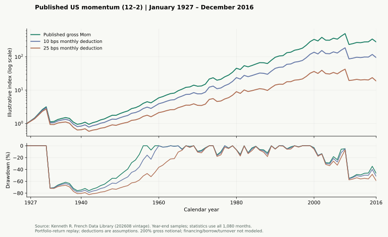

# 第二个公开案例：经典美股动量的历史复现

[在线报告](https://yanxxzz.github.io/quantfactra/momentum/) · [冻结协议](../quantfactra/cases/french_momentum/protocol.json) · [全部结果](published-momentum-result.json) · [来源与哈希](../quantfactra/cases/french_momentum/reference.json)

为正收益展示而有意选择已知经典因子，不是新 Alpha 发现或无偏搜索。QuantFactra 复现 Kenneth French 发布的组合级月度收益，没有从 CRSP 个股重建信号、持仓或交易。与 [ECB / bt 案例](public-research-case.md) 的市场、周期、敞口、基准和成本不同，不能当作同一策略优化前后的收益对照。

## 来源与固定规则

[官方定义](https://mba.tuck.dartmouth.edu/pages/faculty/ken.french/Data_Library/det_mom_factor.html)按规模与过去第 12 至第 2 个月收益形成六个市值加权组合；Mom 为大小盘高动量组合均值减低动量组合均值，每月重组。背景见 [Jegadeesh & Titman (1993)](https://doi.org/10.1111/j.1540-6261.1993.tb04702.x)，风险见 [Daniel & Moskowitz, Momentum Crashes](https://www.nber.org/papers/w20439)。本例采用 French 的构造，不声称复现两篇论文的全部策略。

实际取得的[官方 CSV ZIP](https://mba.tuck.dartmouth.edu/pages/faculty/ken.french/ftp/F-F_Momentum_Factor_CSV.zip)标注 202608 CRSP vintage。协议与研究窗检查先于下载及读取收益：1927-01 至 2016-12，从来源起点取完整 90 年，截止于本仓库既有封存窗前。没有尝试别的年份或参数。解析器只读月度 Mom 区块，百分数除以 100；缺失码、非有限、重复和缺月都停止。

同时固定 1994–2016，即经典论文发表后的完整日历年；仍使用后来修订的数据及已知因子，不构成 clean OOS。两个区间都报告 0 / 10 / 25 bps 固定月度扣减，保留所有结果。

## 完整结果

| 区间 | 固定月度扣减 | 研究指数年化 | 最大回撤 | 最差年度 |
|---|---:|---:|---:|---:|
| 1927–2016 | 0 bps（毛收益） | 6.45% | −78.44% | 1932 / −64.46% |
| 1927–2016 | 10 bps | 5.19% | −80.28% | 1932 / −64.94% |
| 1927–2016 | 25 bps | 3.32% | −82.98% | 1932 / −65.65% |
| 1994–2016 | 0 bps（毛收益） | 3.27% | −57.78% | 2009 / −52.83% |
| 1994–2016 | 10 bps | 2.04% | −58.24% | 2009 / −53.43% |
| 1994–2016 | 25 bps | 0.22% | −59.93% | 2009 / −54.33% |



图按年末取样、净值轴为对数，统计使用完整月序列。`I[t] = I[t-1] * (1 + Mom[t]/100 - drag_bps/10000)`，年化为 `I[T] ** (12/T) - 1`，最大回撤包括期初指数 1。每单位参考资本对应一单位多头和一单位空头，200% 总名义敞口，不加现金或抵押品收益。均值/波动比用零基准及样本标准差，不称完整投资账户的夏普比率。

10 / 25 bps 是每月收益扣减假设，**不是单边交易费**。没有实际换手、融券、融资、冲击或税费，不能称成本后可投资业绩。正收益判断仅指固定全区间毛收益指数年化大于零；更弱区间、崩盘和全部扣减都保留，不因此晋级因子或写入研究池。

## 自己复现

使用当前发布版或 master 源码安装。Python 3.11 / 3.12，无须 bt、PandaAI 账户或模型。

```bash
python -m pip install -e .
python -m quantfactra factor-case --download --output research_runs/french_momentum
python -m quantfactra factor-case --output research_runs/french_momentum --resume
```

打开 `research_runs/french_momentum/report.html`。Windows 未激活环境时把 `python` 换成 `.\.venv\Scripts\python.exe`。手动下载官方 ZIP 后可以完全离线计算：

```bash
python -m quantfactra factor-case --source F-F_Momentum_Factor_CSV.zip --output research_runs/french_momentum_local
```

输出保留原 `source.zip`、协议、月度研究指数、完整指标、HTML 报告、数据说明和 `delivery.json`。已有目录拒绝覆盖；`--resume` 核验完整原件且不下载。每个观察的指数与回撤用另一条 50 位 Decimal 路径核对，公开结果再用 NumPy 从原始输入复核六组聚合指标。

下载失败可以手动保存文件；切片哈希不同则在创建输出前停止。官网只追加月份且冻结切片不变时允许复现；历史值修订后，需要自己保存的旧 ZIP 才能重现本页。不要改 hash 来冒充同一结果。

## 数据与发布边界

[French 数据目录](https://mba.tuck.dartmouth.edu/pages/faculty/ken.french/data_library.html)说明了 2025 年从 FIZ 切换至 CIZ 及历史数据修订。本例未认证逐时点 vintage，也未重建底层个股。

仓库和 Pages 仅发布派生统计、年末抽样图、代码、规则和哈希，不打包原 ZIP 或月度源值。第三方数据不属于软件 MIT 许可，见 [DATA_NOTICE](../quantfactra/cases/french_momentum/DATA_NOTICE.md)。网站构建不访问网络、不运行研究、不读取本机输出目录。

维护者可从完整核验的本地结果生成统计与图表（需 Matplotlib）：

```bash
python scripts/publish_momentum_case.py --case-output research_runs/french_momentum
```

网站构建检查协议、切片、计算实现和图表绑定；比较缺失或绑定变化时拒绝发布。
